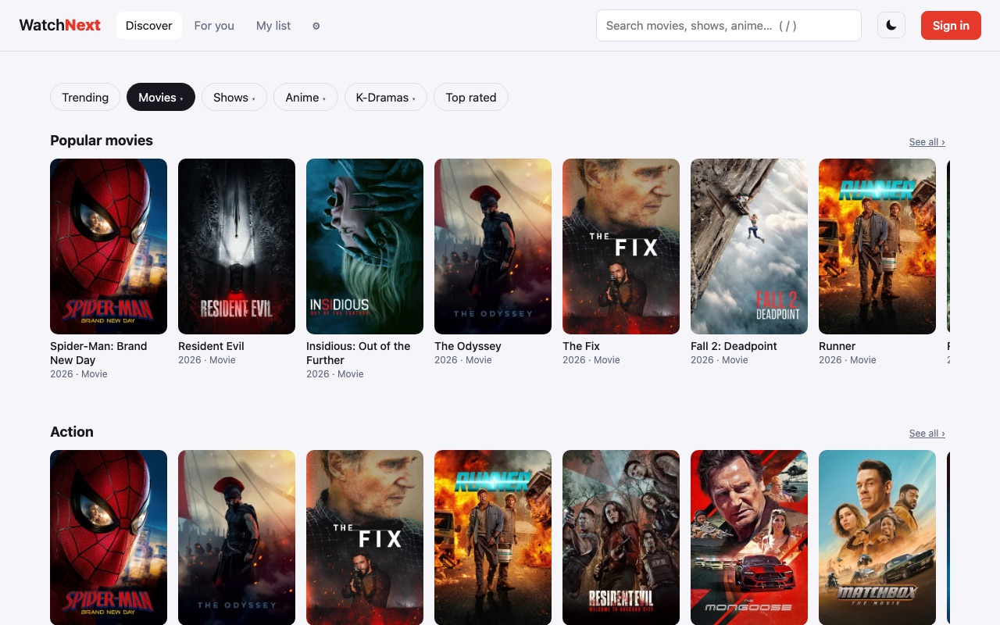
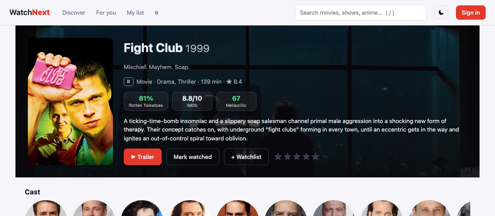
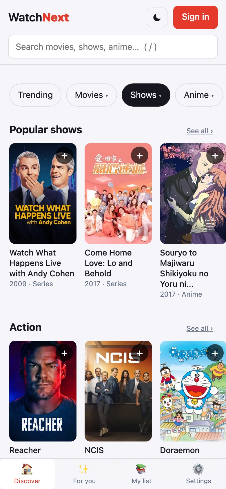
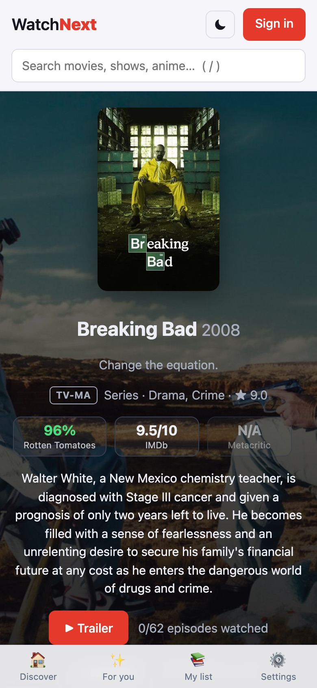

# WatchNext

A watch tracker for movies, TV shows, anime and K-dramas. Browse by genre, keep a watchlist, tick off episodes as you watch, and get recommendations based on what you've rated and finished.

Built with React and Vite, with [Supabase](https://supabase.com) for sign-in, cloud sync and a small API proxy. Titles, posters and trailers come from [TMDB](https://www.themoviedb.org); IMDb, Rotten Tomatoes and Metacritic scores come from [OMDb](https://www.omdbapi.com).

## Screenshots





<p>
  
  &nbsp;
  
</p>

## Features

- **Discover** – Trending, Movies, Shows, Anime, K-Dramas and Top rated. Movies, Shows, Anime and K-Dramas each open a genre menu. A genre page has themed rows (Popular, Top rated, New releases, Hidden gems), and every row has **See all** with Load more.
- **Title pages** – Overview, cast, trailer, similar titles, season and episode lists with episode previews, the MPAA or TV Parental Guidelines rating, and separate Rotten Tomatoes, IMDb and Metacritic scores.
- **My list** – In progress, Watchlist and Finished, filterable by Shows, Movies, Anime or K-Dramas. Mark single episodes, a whole season, or everything "up to here".
- **For you** – Recommendations built from your ratings and viewing history, with a taste profile.
- **Extras** – New-episode alerts for shows you follow, a spoiler shield that blurs episodes you haven't watched, search with suggestions, person pages with filmographies, light and dark mode, and a mobile layout with a bottom tab bar.
- **Accounts** – Works without signing in (data stays in your browser). Sign in with email or Google to sync across devices.

## Tech stack

| Part | Used for |
| --- | --- |
| React 18 + Vite | The app (`src/`) |
| Supabase Auth + Postgres | Accounts and your synced list (`library_items`, with row-level security) |
| Supabase Edge Functions | `tmdb` and `ratings` proxies that keep API keys off the browser |
| TMDB API | Titles, images, trailers, ratings, genres |
| OMDb API | IMDb / Rotten Tomatoes / Metacritic scores |

## Getting started

You need Node 18+, a Supabase project, a [TMDB API key](https://www.themoviedb.org/settings/api) and, optionally, a [free OMDb key](https://www.omdbapi.com/apikey.aspx).

```bash
git clone https://github.com/Ayush-Gopisetty/WatchNext.git
cd WatchNext
npm install
cp .env.example .env     # then fill in the two values below
npm run dev
```

`.env` (browser-safe values only):

```
VITE_SUPABASE_URL=https://<your-project-ref>.supabase.co
VITE_SUPABASE_ANON_KEY=<your anon / publishable key>
```

> Never put the TMDB or OMDb key in a variable that starts with `VITE_`. Vite copies those into the code sent to browsers. The keys belong in Supabase secrets (below). `.env` is git-ignored.

### Set up the backend

The app can't load titles until the database and both functions are set up. Commands use `npx supabase`, so there's nothing to install globally.

```bash
npx supabase login
npx supabase link --project-ref <your-project-ref>

# 1. Database tables and policies (supabase/migrations)
npx supabase db push

# 2. API keys, stored as secrets on Supabase (never in the repo)
npx supabase secrets set TMDB_KEY=<your TMDB key>
npx supabase secrets set OMDB_KEY=<your OMDb key>      # optional

# 3. Deploy the functions
npx supabase functions deploy tmdb
npx supabase functions deploy ratings
```

Without `OMDB_KEY`, the app works normally and simply doesn't show the Rotten Tomatoes, IMDb and Metacritic scores.

In the Supabase dashboard, set **Authentication → URL Configuration** to your site URL. To use Google sign-in, enable the Google provider.

## How the backend works

- **`tmdb` function** – The browser never calls TMDB directly. It sends a path and parameters to this function, which only accepts an allow-list of TMDB paths, adds the secret key and caches responses in the `tmdb_cache` table (6 hours for lists, 72 hours for details). New TMDB endpoints must be added to the `ALLOW` list in `supabase/functions/tmdb/index.ts` and redeployed.
- **`ratings` function** – Looks up scores by IMDb ID and caches each title for 7 days. It counts every real OMDb request per day. Once OMDb's daily limit is reached, or the count hits `OMDB_DAILY_LIMIT` (default 1000, the free tier), the app hides scores everywhere until the next day.
- **Cache table access** – `tmdb_cache` has row-level security with no policies, so only the functions (service role) can read it. Migration `0003` grants that role access. Newer Supabase projects need this.

Check today's OMDb usage:

```bash
curl -s -X POST "$VITE_SUPABASE_URL/functions/v1/ratings" \
  -H "apikey: $VITE_SUPABASE_ANON_KEY" -H "Authorization: Bearer $VITE_SUPABASE_ANON_KEY" \
  -H 'Content-Type: application/json' -d '{"usage":true}'
```

To raise the limit after upgrading your OMDb plan: `npx supabase secrets set OMDB_DAILY_LIMIT=<number>`.

## Project layout

```
src/
  App.jsx          routes (hash-based) and the page shell
  pages.jsx        Discover, Search, My list, For you, Settings
  Detail.jsx       title page, seasons and episodes, score tiles
  Person.jsx       actor / crew page
  api.js           TMDB + ratings calls, genre lists, data shaping
  store.js         your list: localStorage, plus cloud sync when signed in
  recommend.js     taste profile and recommendations
  ui.jsx           shared pieces (cards, rows, trailer popup, loaders, errors)
  Login.jsx, Auth.jsx, SearchBox.jsx, supabase.js, styles.css
supabase/
  migrations/      database schema (run with `supabase db push`)
  functions/       tmdb and ratings edge functions
```

## Scripts

| Command | What it does |
| --- | --- |
| `npm run dev` | Start the dev server |
| `npm run build` | Production build into `dist/` |
| `npm run preview` | Serve the production build locally |

## Deploying

The site is a static build (`npm run build`, output in `dist/`) and can be hosted anywhere. Set `VITE_SUPABASE_URL` and `VITE_SUPABASE_ANON_KEY` in your host's environment settings, then add the site's URL in Supabase under Authentication → URL Configuration.

## Notes and limits

- Rotten Tomatoes and Metacritic scores come from OMDb, which has patchy coverage for TV, anime and K-dramas. Missing scores show as N/A.
- Ratings come from TMDB's US data (MPAA for movies, TV Parental Guidelines for shows). If a title has no US rating, another country's rating appears with its country code.
- Anime means Japanese-language animation. K-Dramas means Korean-language series made in Korea.

## Credits

This product uses the TMDB API but is not endorsed or certified by [TMDB](https://www.themoviedb.org). Scores are provided through the [OMDb API](https://www.omdbapi.com).
